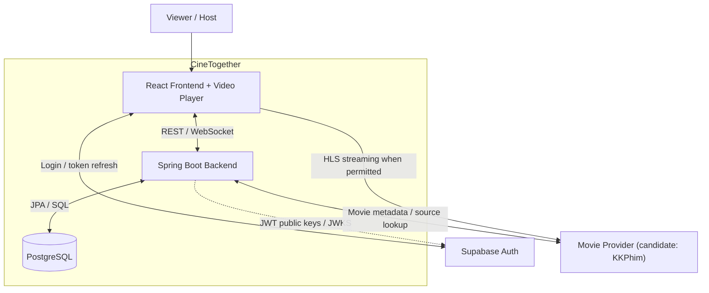
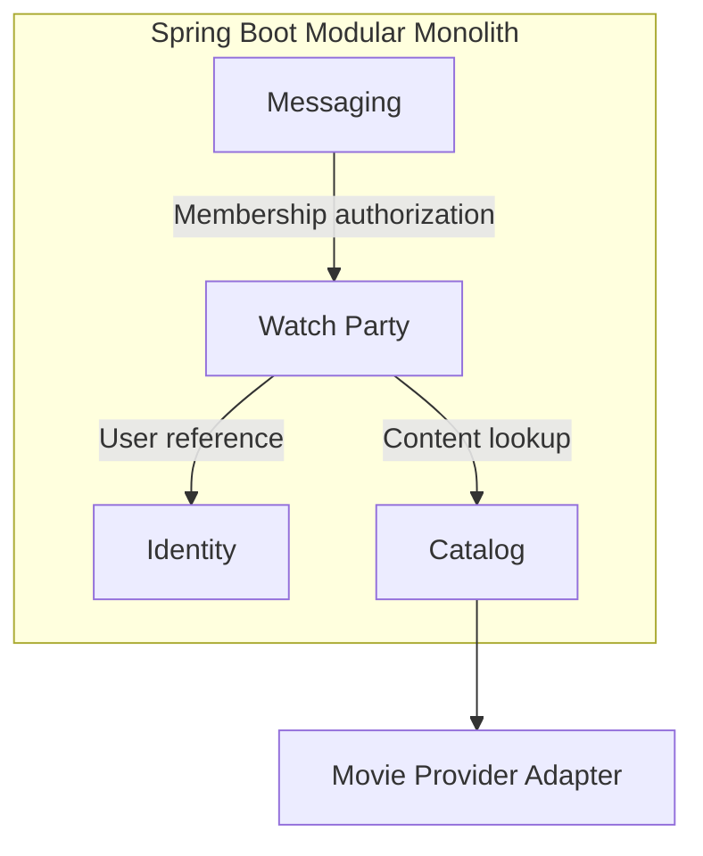
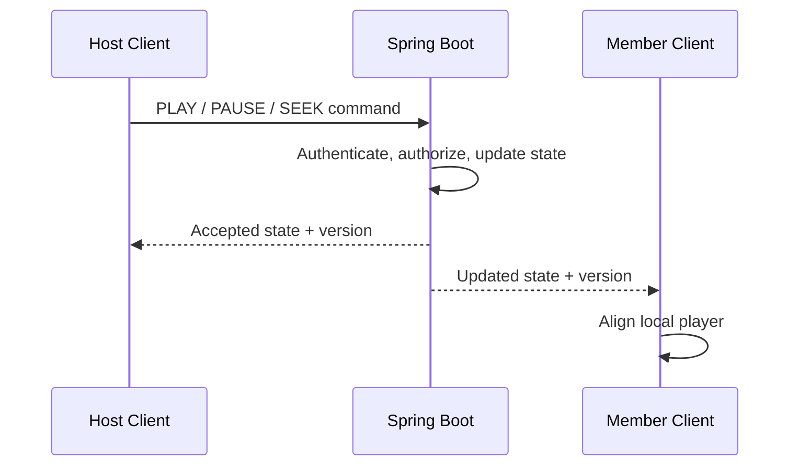

# CineTogether — System Architecture

**Version:** 0.4  
**Status:** Draft — High-Level Design  
**Phase:** Planning & Design

## 1. Purpose & Architectural Principles

This document describes the high-level structure of CineTogether: its major components, backend module boundaries,
communication patterns, and key technical decisions. Product behavior and business rules are defined
in [Product Requirements](../product/requirements.md). Database schemas, API contracts, and synchronization algorithms
belong in the detailed design documents.

The architecture follows these principles:

- **Modular monolith:** One deployable Spring Boot backend, organized into business modules.
- **Module-first, layer-second:** Organize code by capability; add internal layers only where useful.
- **Pragmatic separation of concerns:** Keep domain rules distinct from HTTP, WebSocket, persistence, and
  provider-specific code.
- **Backend-enforced authorization:** Clients never determine room membership or Host privileges.
- **Server-authoritative shared state:** The backend decides the accepted Watch Party state; clients synchronize their
  players to it.
- **Incremental design:** Prefer the simplest design that meets MVP needs; revise significant decisions as
  implementation provides evidence.

## 2. Technology Stack

| Area              | Technology / Direction                                    |
|-------------------|-----------------------------------------------------------|
| Backend           | Java 21, Spring Boot 4.x, Gradle Kotlin DSL               |
| Modularity        | Spring Modulith; single Gradle project                    |
| Persistence       | PostgreSQL, Spring Data JPA, Flyway                       |
| Security          | Spring Security OAuth2 Resource Server                    |
| Authentication    | Supabase Auth (chosen direction; integration to validate) |
| Frontend          | React                                                     |
| Communication     | REST and WebSocket                                        |
| Video             | HTML5 video / HLS.js where required                       |
| Movie integration | KKPhim prototype; production provider unconfirmed         |
| Testing           | JUnit, Spring Boot Test, Testcontainers                   |
| Local development | Docker Compose                                            |

## 3. Container Architecture — C4 Level 2



**React frontend** handles browsing, playback UI, Watch Party interactions, local player synchronization, and connection
feedback. It is not authoritative for shared room state.

**Spring Boot backend** provides APIs, authorizes operations, manages Watch Party state, coordinates realtime events,
and integrates with movie providers.

**PostgreSQL** stores business data requiring persistence or transactional consistency. The playback snapshot and
membership
presence are persisted in PostgreSQL; live WebSocket connection objects stay in application memory.

**External services:** Supabase Auth handles login and token issuance. Spring Security validates tokens and enforces
access to protected endpoints; application-level rules still belong to CineTogether. KKPhim is an experimental
integration, not yet an approved production media source.

Video segments are delivered to each browser directly by a permitted source, not relayed through the Host or Spring
Boot. Compatibility, browser restrictions, and content usage rights must be verified.

## 4. Backend Modules — C4 Level 3 (Module View)

| Proposed module | Responsibility                                                                                       |
|-----------------|------------------------------------------------------------------------------------------------------|
| `identity`      | Application user identity and profiles, if needed                                                    |
| `catalog`       | Movie metadata, episodes, provider adapter                                                           |
| `watchparty`    | Room lifecycle, visibility, membership, Host ownership, shared playback state, public room discovery |
| `messaging`     | Room chat and temporary message history                                                              |



These are **proposed boundaries**, not a requirement to create every module immediately. In particular, `messaging` can
remain within `watchparty` if a separate module adds more coupling than value. Supabase handles authentication;
`identity` must not duplicate a password-management system.

Modules expose only the interfaces needed by other modules; their internal repositories and implementation classes
remain private. Spring Modulith should verify module dependencies and detect cycles.

An indicative package structure is:

```text
com.thanh.cinetogether/
├── CinetogetherApplication.java
├── identity/
├── catalog/
├── watchparty/
├── messaging/
└── config/
```

The base package is `com.thanh.cinetogether`; Spring Modulith derives module boundaries from the direct subpackages of
the application class's package.

Within a module, introduce `domain`, `application`, `infrastructure`, or `web` packages only as complexity warrants.
Package names and boundaries may evolve during implementation.

The `identity` module is the reference layout, and later modules follow it:

```text
identity/
├── ProfileProvisioner.java   public API of the module: the only type other modules may use
├── application/              use cases and transactions (Profiles)
├── domain/                   business rules in plain Java, no framework (DisplayNames)
├── persistence/              JPA entities, repositories, SQL (AppUser, UserProfiles)
└── web/                      controllers and request/response types (MeController)
```

Dependencies point inward: `web` → `application` → `domain` and `persistence`; `domain` depends on nothing else. Types
used across these packages are `public`, but Spring Modulith treats subpackages as internal, so only the public types in
the module's root package are visible to other modules. `ModularityTests` enforces this (the compiler does not). A type
returned by `application` and serialized as JSON lives in `application`, not `web`, to keep the dependency direction.

Inside one of these packages, files that belong together are grouped by concept, not by count: for example
`catalog/domain/movie` (movie types), `catalog/domain/browse` (query rules) and `catalog/infrastructure/kkphim`
(everything specific to one provider, so a second provider gets its own folder). Tests mirror the production packages;
only checks that span the whole application (`ModularityTests`) and shared test setup stay at the test root.

## 5. Communication & Key Flows

### 5.1. Authentication

React uses Supabase Auth for sign-in and token renewal. Protected REST and WebSocket operations must establish the
authenticated user and enforce backend authorization. JWT verification should use a signing method supported by the
Supabase project; asymmetric signing with JWKS is the preferred direction. WebSocket connections authenticate with an
`AUTH`
message and renew tokens with a repeated `AUTH` (see [API Design](../design/api.md)). The exact Spring Security
configuration is deferred to implementation design.

### 5.2. Movie Playback

The frontend requests movie details and an authorized playback source through CineTogether. The backend uses the catalog
provider adapter to resolve content. For supported sources, each browser streams video independently; the backend does
not serve the movie bytes.

### 5.3. Shared Watch Party Playback



The backend keeps the authoritative content selection, playback status, reference position/time, and state version.
WebSocket distributes changes; clients recover from missed or stale events by retrieving current state. Clients correct
meaningful drift locally, and one participant's buffering does not pause everyone else. Exact algorithms and thresholds
belong in [Watch Party Design](../design/watch-party.md).

### 5.4. Room Membership & Chat

Membership and connection presence are distinct: a temporarily disconnected user may still hold a room membership. Room
capacity, ownership changes, and expiry require consistent server-side state transitions. Chat messages must be
authorized against current room membership; temporary history follows the retention policy
in [Product Requirements](../product/requirements.md).

REST is primarily used for catalog queries, room creation/joining, and state retrieval. WebSocket carries playback
commands/updates, membership changes, and chat events. Exact routes and event payloads belong
in [API Design](../design/api.md).

**Public rooms.** PRIVATE and PUBLIC rooms run on the same `watchparty` engine and tables; visibility only controls
entry by room ID and inclusion in a read-only public discovery/preview API. That API is unauthenticated, rate-limited,
and uses dedicated response DTOs that never include invitation codes or member identities. It does not call the movie
provider; clients resolve titles and posters through the catalog API.

## 6. Cross-Cutting Concerns

- **Security:** Validate JWTs; enforce room membership and Host permissions on REST and WebSocket operations; validate
  input and protect secrets. Public discovery endpoints expose only
  whitelisted PUBLIC-room fields and are rate-limited.
- **Consistency & recovery:** Use transactions/concurrency control for competing state changes; version shared playback
  updates; allow clients to retrieve authoritative state after reconnecting.
- **Testing:** Unit-test core rules, integration-test persistence/APIs with Testcontainers, verify module boundaries
  with Spring Modulith, and test critical concurrent/realtime scenarios.
- **Observability:** Use useful structured logs, error responses, and Spring Boot Actuator health endpoints, especially
  around room lifecycle and WebSocket failures.
- **Deployment:** Start with one Spring Boot instance, PostgreSQL, and a separately served React frontend. Distributed
  state management is deferred until justified.

## 7. Decisions & Open Technical Questions

**Current architectural decisions:** Modular monolith; single Gradle project; Spring Modulith; PostgreSQL; REST +
WebSocket; server-authoritative synchronized playback; independent client-side media streaming; and replaceable external
integrations.

**To resolve before implementing the affected features:**

- Authentication: Confirm the Supabase project's JWT signing keys/JWKS (the WebSocket flow and token renewal are defined
  in API Design).
- Movie provider: Validate usable playback controls, availability, and rights for production use.
- Messaging: Confirm module boundary and temporary message storage/cleanup approach.
- Deployment: Choose hosting and runtime configuration when preparing release.

Microservices, Kafka, Redis, Kubernetes, and LiveKit are **not MVP dependencies**. Add infrastructure only to address a
demonstrated requirement.

## 8. Related Documents

- [Product Overview](../product/overview.md)
- [Product Requirements](../product/requirements.md)
- [Watch Party Design](../design/watch-party.md)
- [Database Design](../design/database.md)
- [API Design](../design/api.md)

---

*This is a living HLD. Update it when a significant architectural decision changes, rather than mirroring every product
requirement or implementation detail.*
