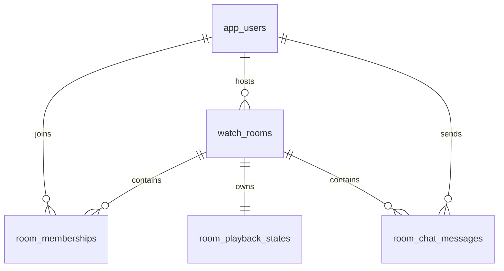

# CineTogether — Database Design

**Version:** 0.5  
**Status:** Draft — Proposed MVP Schema  
**Database:** PostgreSQL · Spring Data JPA · Flyway

## 1. Scope & Design Choices

This document defines the proposed PostgreSQL schema for the CineTogether MVP, including entities, relationships,
constraints, indexes, and transaction boundaries.

Business requirements and Watch Party behavior are documented separately
in [Product Requirements](../product/requirements.md) and [Watch Party Design](watch-party.md).

### 1.1. Database Entities

The MVP uses five tables:

| Entity                 | Responsibility                                                 |
|------------------------|----------------------------------------------------------------|
| `app_users`            | Application user profiles                                      |
| `watch_rooms`          | Room ownership and lifecycle                                   |
| `room_memberships`     | Room participation, membership status, and connection tracking |
| `room_playback_states` | Authoritative shared playback state                            |
| `room_chat_messages`   | Temporary room chat messages                                   |

### 1.2. Design Decisions

- Use UUIDs for users, rooms, and memberships.
- Use `BIGINT` identity values for chat message IDs.
- Use `TIMESTAMPTZ` for timestamps, handled consistently in UTC.
- Use database constraints to protect data integrity.
- Use Flyway for version-controlled schema migrations.
- Use PostgreSQL transactions for operations affecting room consistency.

Supabase Auth manages authentication credentials and sessions. Movie metadata and episodes come from an external
provider. WebSocket runtime connections are managed by the backend.

These responsibilities do not require additional application database tables in the MVP.

The authoritative playback snapshot is proposed to be persisted in PostgreSQL, while actual WebSocket connection objects
remain in application memory.

## 2. Entity Relationships



### Relationship Summary

- One user can host multiple rooms over time.
- One room has at most one designated Host (none while it awaits a Host).
- One user can have memberships in multiple rooms.
- Each user has at most one membership record per room.
- One room has exactly one playback state record.
- One room can contain multiple chat messages.
- Each chat message belongs to one sender and one room.

Host ownership is represented by `watch_rooms.host_user_id`, not by a separate Host entity.

## 3. Tables & Fields

### 3.1. `app_users`

Stores application-specific user profile information.

| Column         | Type        | Nullable | Description                        |
|----------------|-------------|----------|------------------------------------|
| `id`           | UUID        | No       | Primary key; Supabase Auth user ID |
| `display_name` | VARCHAR(80) | No       | Public display name                |
| `created_at`   | TIMESTAMPTZ | No       | Profile creation time              |
| `updated_at`   | TIMESTAMPTZ | No       | Last profile update                |

**Constraints**

- Primary key: `id`.
- `display_name` must not be blank after trimming.

**Design Notes**

- `id` corresponds to the validated `sub` claim from the Supabase access token.
- The profile is created by an idempotent upsert (`INSERT … ON CONFLICT (id) DO NOTHING`) performed by the
  authentication layer on every authenticated request and WebSocket `AUTH`, before any room operation, in its own short
  transaction.
- Initial `display_name`: trimmed `user_metadata.display_name` from the token, else the email local part, else
  `Viewer-` plus the first 6 characters of the user ID; truncated to 80 characters and never blank. A candidate with
  control or invisible format characters, or with nothing visible, is skipped. `user_metadata` is editable by the
  client, so it only suggests a name.
- A user can change the name through `PATCH /me` (`api.md` §2.1), which also sets `updated_at`. The 80 characters are
  counted as characters, not UTF-16 units. The database check only trims ASCII whitespace, so the application also
  rejects names made of other invisible characters.
- Concurrent profile creation must not produce duplicate records.
- Passwords, refresh tokens, and authentication sessions are not stored here.
- There is no foreign key to Supabase's `auth.users` because identity is managed externally.

### 3.2. `watch_rooms`

Stores room identity, Host ownership, and lifecycle information.

| Column         | Type        | Nullable | Description                                                          |
|----------------|-------------|----------|----------------------------------------------------------------------|
| `id`           | UUID        | No       | Primary key                                                          |
| `invite_code`  | VARCHAR(64) | No       | Unique invitation code, generated for every room                     |
| `visibility`   | VARCHAR(7)  | No       | `PRIVATE` (default) or `PUBLIC`; fixed at creation                   |
| `host_user_id` | UUID        | Yes      | Current Host; `NULL` while the room awaits a Host                    |
| `status`       | VARCHAR(10) | No       | `ACTIVE`, `ENDED`                                                    |
| `created_at`   | TIMESTAMPTZ | No       | Room creation time                                                   |
| `expires_at`   | TIMESTAMPTZ | No       | Maximum room expiration deadline                                     |
| `empty_since`  | TIMESTAMPTZ | Yes      | Since when no member is `CONNECTED`; set to `created_at` on creation |
| `ended_at`     | TIMESTAMPTZ | Yes      | Room termination time                                                |
| `end_reason`   | VARCHAR(24) | Yes      | Reason for termination                                               |

**Constraints**

- Primary key: `id`.
- Foreign key: `host_user_id` → `app_users.id`.
- Unique constraint: `invite_code`.
- `expires_at > created_at`.
- `status IN ('ACTIVE', 'ENDED')`.
- `visibility IN ('PRIVATE', 'PUBLIC')`, default `'PRIVATE'`.
- `ACTIVE` rooms must have null `ended_at` and `end_reason`.
- `ENDED` rooms must have non-null `ended_at` and `end_reason`.

Supported termination reasons:

- `HOST_ENDED`
- `MAX_LIFETIME`
- `EMPTY_TIMEOUT`
- `LAST_MEMBER_LEFT` (the Host leaves and no `CONNECTED` or unexpired `DISCONNECTED` member remains)

**Design Notes**

- Invitation codes must be generated using a cryptographically secure random generator.
- Possession of an invitation code does not bypass authentication or room authorization.
- `visibility` affects only whether a room can be joined by `id` and whether it appears in public discovery. It is never
  updated after creation. `PUBLIC` rooms keep their `invite_code` as an alternative way in.
- `host_user_id` references the current designated Host, including during the temporary-disconnection grace period. It
  is non-null at creation.
- When the Host loses eligibility (reservation expired or voluntary leave) and no `CONNECTED` successor exists,
  `host_user_id` is set to `NULL` in the same transaction: the room is **awaiting a Host**. No other column or status
  marks this state. `NULL` is meaningful only on `ACTIVE` rooms; an `ENDED` room keeps its last value.
- Host-only commands require `host_user_id` to reference a `CONNECTED` member with the current `connection_id`; a
  `NULL` value authorizes nobody.
- `host_user_id` changes only through Host transfer, failover or Host leave (successor or `NULL`), or a committed
  WebSocket attachment into a room whose `host_user_id` is `NULL`, all under the room lock. REST Join never changes it,
  so a previous Host who rejoins cannot block or pre-empt recovery.
- `empty_since` is set to `created_at` on creation, set when the last `CONNECTED` member detaches or leaves, and cleared
  when any member attaches. It is based on connected members, not reserved membership slots.
- An active room may temporarily have no connected members.

A room cannot transition from `ENDED` back to `ACTIVE`.

### 3.3. `room_memberships`

Stores a user's participation in a room, including connection and reconnection state.

| Column                  | Type        | Nullable | Description                               |
|-------------------------|-------------|----------|-------------------------------------------|
| `id`                    | UUID        | No       | Primary key                               |
| `room_id`               | UUID        | No       | Referenced room                           |
| `user_id`               | UUID        | No       | Referenced user                           |
| `status`                | VARCHAR(16) | No       | Membership status                         |
| `joined_at`             | TIMESTAMPTZ | No       | Time of the current join                  |
| `status_changed_at`     | TIMESTAMPTZ | No       | Last membership status change             |
| `connection_id`         | UUID        | Yes      | Current authorized Watch Party connection |
| `reconnect_deadline_at` | TIMESTAMPTZ | Yes      | Deadline for connection recovery          |

Supported membership statuses:

- `CONNECTED`
- `DISCONNECTED`
- `LEFT`
- `REMOVED`
- `EXPIRED`

**Constraints**

- Primary key: `id`.
- Foreign key: `room_id` → `watch_rooms.id`.
- Foreign key: `user_id` → `app_users.id`.
- Unique constraint: `(room_id, user_id)`.
- `status` must match one of the supported values.
- `CONNECTED` requires a `connection_id` and no reconnect deadline.
- `DISCONNECTED` requires a reconnection deadline and no active `connection_id`.
- Terminal statuses (`LEFT`, `REMOVED`, `EXPIRED`) require neither.

**Design Notes**

One user occupies at most one membership slot per room, even when using multiple devices.

`CONNECTED` and `DISCONNECTED` memberships count toward room capacity.

When a user connects from another device, the backend replaces the active `connection_id` without creating another
membership.

A delayed disconnect from an old connection must not invalidate the replacement connection.

When the reconnection period expires, the membership becomes `EXPIRED` and releases its reserved slot.

A user returning after `LEFT`, `EXPIRED`, or `REMOVED` may reuse the membership record through the normal join flow,
with `joined_at` refreshed, a new 30-second reservation, and the capacity check repeated. Kick is not a ban.

A `REMOVED` membership cannot be restored through reconnection or by an old connection: removal clears `connection_id`
and the deadline, so a new Join followed by a new successful WebSocket `AUTH` is required.

Create and Join create (or reuse) the membership as `DISCONNECTED` with `reconnect_deadline_at = now + 30 seconds`, the
same reservation period used for reconnection. A repeated Join for an existing unexpired reservation changes nothing.
WebSocket attachment sets `CONNECTED`, assigns `connection_id`, and clears the deadline.

A `DISCONNECTED` membership whose deadline has passed is treated as `EXPIRED` for capacity checks, snapshots, and
eligibility, even if the scheduled sweep has not persisted the change. Capacity counts only `CONNECTED` and unexpired
`DISCONNECTED` rows.

On backend startup, every `CONNECTED` membership becomes `DISCONNECTED` with `reconnect_deadline_at = now + 30 seconds`
and `connection_id = NULL`, because connection objects do not survive a restart.

### 3.4. `room_playback_states`

Stores the authoritative playback snapshot of each room.

| Column                | Type         | Nullable | Description                                  |
|-----------------------|--------------|----------|----------------------------------------------|
| `room_id`             | UUID         | No       | Primary key and room reference               |
| `provider_key`        | VARCHAR(50)  | Yes      | Movie provider identifier                    |
| `movie_external_id`   | VARCHAR(255) | Yes      | Movie identifier from provider               |
| `episode_external_id` | VARCHAR(255) | Yes      | Episode identifier from provider             |
| `status`              | VARCHAR(10)  | No       | `PLAYING`, `PAUSED`                          |
| `position_ms`         | BIGINT       | No       | Reference playback position                  |
| `reference_at`        | TIMESTAMPTZ  | No       | Timestamp associated with reference position |
| `version`             | BIGINT       | No       | Increasing state revision                    |

**Constraints**

- Primary key and foreign key: `room_id` → `watch_rooms.id`.
- `status IN ('PLAYING', 'PAUSED')`.
- `position_ms >= 0`.
- `version >= 0`.
- `provider_key` and `movie_external_id` must either both be present or both be null.
- `episode_external_id` requires a selected movie.
- `PLAYING` requires a selected movie.

**Design Notes**

Each room has exactly one playback state record, created with the room.

The initial state is:

```text
status = PAUSED
position_ms = 0
version = 0
movie_external_id = null
episode_external_id = null
```

Playback time does not need to be written to PostgreSQL every second.

While playing, the backend calculates the expected position using the reference position and elapsed time.

Accepted Play, Pause, Seek, or Change Content commands update the stored snapshot and increment `version`.

Playback updates must be authorized against the current Host.

The table stores provider identifiers rather than video files, HLS URLs, or complete movie metadata.

### 3.5. `room_chat_messages`

Stores temporary text messages exchanged within a Watch Party.

| Column           | Type            | Nullable | Description                   |
|------------------|-----------------|----------|-------------------------------|
| `id`             | BIGINT IDENTITY | No       | Primary key                   |
| `room_id`        | UUID            | No       | Referenced room               |
| `sender_user_id` | UUID            | No       | Message sender                |
| `content`        | VARCHAR(1000)   | No       | Message text                  |
| `created_at`     | TIMESTAMPTZ     | No       | Server-assigned creation time |

**Constraints**

- Primary key: `id`.
- Foreign key: `room_id` → `watch_rooms.id`.
- Foreign key: `sender_user_id` → `app_users.id`.
- `content` must not be blank after trimming.

**Design Notes**

- Messages are append-only in the MVP.
- The backend verifies room membership before accepting a message.
- Retrieve up to 50 recent messages for an active room.
- Chat history becomes inaccessible when the room ends.
- Temporary messages must be deleted within the retention deadline defined in Product Requirements.

The number of messages stored during an active room is not restricted to 50; this is only the retrieval limit.

## 4. Constraints & Indexes

### 4.1. Data Integrity

Primary keys, foreign keys, unique constraints, and check constraints protect the structural integrity of persisted
data.

Important business invariants that involve multiple rows or changing state—such as room capacity, eligible Host
ownership, and authorized playback updates—must additionally be enforced through transactional application logic.

### 4.2. Indexes

| Index                                                                            | Purpose                                    |
|----------------------------------------------------------------------------------|--------------------------------------------|
| `UNIQUE watch_rooms(invite_code)`                                                | Invitation-code lookup                     |
| `UNIQUE room_memberships(room_id, user_id)`                                      | Membership lookup and duplicate prevention |
| `room_chat_messages(room_id, created_at DESC, id DESC)`                          | Recent room messages                       |
| `watch_rooms(expires_at) WHERE status = 'ACTIVE'`                                | Active-room expiration                     |
| `watch_rooms(empty_since) WHERE status = 'ACTIVE' AND empty_since IS NOT NULL`   | Empty-room timeout checks                  |
| `watch_rooms(created_at DESC) WHERE status = 'ACTIVE' AND visibility = 'PUBLIC'` | Public discovery listing                   |
| `room_memberships(reconnect_deadline_at) WHERE status = 'DISCONNECTED'`          | Reservation expiry sweep                   |

Primary keys and unique constraints automatically provide supporting indexes.

Additional indexes should be introduced only when query patterns justify them.

### 4.3. Referential Integrity

Foreign keys use restrictive deletion behavior by default.

Dependent data must be cleaned up intentionally rather than removed through broad cascading deletes.

Temporary chat messages are deleted according to their retention policy.

Historical room and membership records may remain available for operational consistency unless a separate data-cleanup
policy is introduced.

### 4.4. Public Discovery Queries

Discovery and preview are read-only queries that take no room lock. They select only `PUBLIC` rooms with
`status = 'ACTIVE'`, `expires_at > now`, and `empty_since IS NULL OR empty_since + 15 minutes > now`, so rooms past
either
deadline are hidden even before cleanup ends them. `participantCount` counts memberships that are `CONNECTED` or
`DISCONNECTED` with an unexpired deadline (the slots counted for capacity). The Host display name comes from a
left join on `app_users` via `host_user_id`, shown only when that user's membership is `CONNECTED` or `DISCONNECTED`
with
`reconnect_deadline_at > now`; otherwise it is null, so an expired Host's name never leaks before cleanup clears
`host_user_id`. The listing returns rooms with `participantCount >= 1`, newest `created_at` first, with offset
pagination. Direct preview and join-by-ID apply the same visibility, status, and deadline filters but not the
`participantCount >= 1` filter. Queries use dedicated projections that never
read `invite_code`, member identities, or chat. They never persist `ENDED`; that happens on the next locked operation or
scheduled sweep.

## 5. Transactions & Concurrency

Transactions are required for operations that could violate room or playback consistency when executed concurrently.

### 5.1. Transaction Strategy

PostgreSQL transactions with a single room-row lock are the MVP approach (see [Watch Party Design](watch-party.md)
§7.4).

Every operation on an existing room that changes room, membership, Host, playback, or chat state locks the
`watch_rooms` row with `SELECT … FOR UPDATE` first, then reads and writes the related membership and playback rows. Join
resolves the room by `invite_code` (or by `id` for a `PUBLIC` room) without a lock, then locks by `id` and rechecks
`status` and, for ID joins, `visibility`. The application-user upsert
runs beforehand in its own transaction. Because the room row is the only lock, lock-order cycles cannot occur.

**Create Room is the exception:** there is no existing row to lock. A single transaction inserts `watch_rooms`, the
creator's `room_memberships` row, and the initial `room_playback_states` row; if any insert fails, the whole
transaction rolls back. No `FOR UPDATE` is needed because no other transaction can reference the new room before it
commits.

Inside the lock, the backend first checks both expiration deadlines (`expires_at` and `empty_since + 15 minutes`). An
expired room is persisted as `ENDED` with `MAX_LIFETIME` or `EMPTY_TIMEOUT` and that transition is committed before the
operation is rejected (see [Watch Party Design](watch-party.md) §7.4). Otherwise, expired `DISCONNECTED` memberships are
normalized to `EXPIRED` and Host failover is applied when needed before the operation itself is validated.

Transactions stay short and exclude external movie provider requests: provider validation happens first, and the
transaction revalidates room state, Host eligibility, connection, and `expectedVersion` before committing.

### 5.2. Critical Operations

| Operation                      | Required consistency                                                                                   |
|--------------------------------|--------------------------------------------------------------------------------------------------------|
| Create Room                    | Create room, initial membership, and playback state together                                           |
| Join Room                      | Validate room state and capacity without overbooking                                                   |
| Reconnect / Replace Connection | Preserve membership and reject stale connection changes                                                |
| Attach (WebSocket)             | Set `CONNECTED`, clear deadline and `empty_since`, and assign Host if the room awaits one — atomically |
| Leave / Remove Member          | Release membership; apply Host Leave Cases A–C; update `empty_since`                                   |
| Transfer Host                  | Ensure one valid Host ownership transition                                                             |
| Playback Command               | Validate current Host and update playback version atomically                                           |
| End Room                       | Prevent subsequent room operations                                                                     |
| Send Chat                      | Ensure room and membership remain valid when accepting a message                                       |

### 5.3. Concurrency Considerations

**Concurrent Join**

When multiple users attempt to occupy the final available slot, capacity validation and membership changes must execute
consistently within a transaction.

**Host Transfer**

The backend must validate the current Host and eligible successor before committing an ownership change.

**Host Assignment**

Leave, attach/reconnect, Host transfer, and room expiration all take the room lock. Whichever commits first decides the
Host; later operations revalidate against the committed state, so conflicting Host assignments cannot occur.

**Connection Replacement**

A delayed disconnect event must only affect a membership if it still refers to the currently authorized connection.

**Playback Updates**

Concurrent playback commands must not produce stale or conflicting authoritative state.

**Room Termination**

Operations that race with room termination must either complete consistently before termination or be rejected.

### 5.4. Timeout Processing

Room expiration, reconnection deadlines, and temporary data cleanup may use simple scheduled processing within the
single backend instance.

Timeout handlers must recheck the current database state and relevant deadlines before applying changes.

Expired rooms must also be rejected during normal protected operations, even if scheduled cleanup has not run yet.

Persisted deadlines allow the application to recover pending expiration work after a restart.

Host failover is performed when the Host's reservation expires; no separate Host timer is needed. Stale `CONNECTED`
memberships left by a restart are reset by the startup recovery described in §3.3.

## 6. Open Decisions

The proposed schema covers the current MVP, but several implementation details require validation.

| Area           | Remaining Decision                                                  |
|----------------|---------------------------------------------------------------------|
| Movie Provider | Verify stable provider IDs and playback compatibility               |
| Cleanup        | Finalize the scheduled retention and expiration processing strategy |

These decisions should be resolved before implementing the affected functionality.

They do not require additional entities at this stage.

## 7. Related Documents

- [Product Requirements](../product/requirements.md)
- [System Architecture](../architecture/architecture.md)
- [Watch Party Design](watch-party.md)
- [API Design](api.md)

---

*This document defines the proposed CineTogether MVP database schema. Database migrations and integration tests will
validate these design decisions during implementation.*