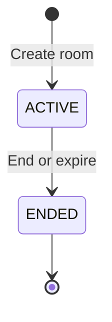

# CineTogether — Watch Party Design

**Version:** 0.5  
**Status:** Draft — Detailed Design  
**Phase:** Planning & Design

## 1. Overview

This document describes the internal design of CineTogether's Watch Party functionality.

It focuses on:

- Room lifecycle and state management.
- Membership, presence, and connection handling.
- Host ownership and transfer.
- Synchronized playback.
- Concurrency and failure recovery.

Product rules are defined in [Product Requirements](../product/requirements.md). System-wide architectural decisions are
defined in [System Architecture](../architecture/architecture.md).

Database schemas and API/WebSocket contracts are documented separately.

Every rule here applies equally to PRIVATE and PUBLIC rooms; visibility only affects how a room is entered and
discovered (§2.4).

## 2. Domain & State Model

### 2.1. Core Concepts

| Concept           | Responsibility                                                             |
|-------------------|----------------------------------------------------------------------------|
| Room              | Represents a shared watching session and its lifecycle                     |
| Visibility        | `PRIVATE` or `PUBLIC`; fixed at creation; affects entry and discovery only |
| Membership        | Represents a user's participation in a room                                |
| Host              | The current member authorized to manage the room                           |
| Presence          | Indicates whether a member is currently connected                          |
| Active Connection | The connection currently representing a member in a room                   |
| Playback State    | The authoritative shared movie selection and playback state                |

A user has one identity regardless of how many devices they use.

Each user can have at most one active membership per room. Membership is separate from device connections, so
reconnecting or switching devices does not create another participant or consume another room slot.

### 2.2. Room States

Rooms have two lifecycle states:

- **ACTIVE:** The room is available for authorized operations.
- **ENDED:** The room is permanently closed.



An empty room may remain `ACTIVE` until its expiration policy applies.

All room operations must reject ended rooms.

### 2.3. Membership States

A membership can be:

- **CONNECTED:** The member has an active Watch Party connection.
- **DISCONNECTED:** The connection was lost, but the membership remains reserved for reconnection.
- **LEFT:** The member voluntarily left.
- **REMOVED:** The Host removed the member. The user may Join again; removal is not a ban.
- **EXPIRED:** The reconnection period ended without recovery.

`CONNECTED` and `DISCONNECTED` memberships count toward room capacity.

`LEFT`, `REMOVED`, and `EXPIRED` memberships do not reserve room slots.

A reserved `DISCONNECTED` membership counts toward capacity only until its reconnect deadline. A reservation past its
deadline is treated as `EXPIRED` and releases its slot immediately, even if scheduled cleanup has not yet persisted the
change.

An active room records the Host in `host_user_id`, which the Host keeps while their membership is `CONNECTED` or an
unexpired `DISCONNECTED` (reconnect grace). Host-only commands additionally require a `CONNECTED` membership with the
current connection. When the Host's membership becomes `LEFT` or `EXPIRED` and no connected successor exists, the same
transaction sets `host_user_id` to `NULL`: the room is **awaiting a Host** and nobody holds Host authority until the
first WebSocket attachment commits (§5.2). `NULL` is the only marker; no separate status exists.

### 2.4. Room Visibility

A room is `PRIVATE` (default) or `PUBLIC`, chosen at creation and never changed. Visibility is not a state of the
lifecycle and does not alter any other rule. It affects exactly two things:

- **Entry:** Join by invitation code works for every room. Join by room ID works only for `PUBLIC` rooms; a `PRIVATE`
  or unknown ID is reported as not found so private rooms cannot be probed.
- **Discovery:** `PUBLIC` rooms may appear in the public list and preview. List eligibility is stricter than direct
  access (see below).

Membership, capacity, Host ownership and recovery, Kick, reconnection, playback, chat, expiration, and locking are
identical for both types, so no separate public-room service or table exists.

Discovery and preview are read-only projections of `ACTIVE`, `PUBLIC` rooms: they take no room lock, never change
state, and hide rooms past `expires_at` or past the empty-room deadline even if cleanup has not yet ended them.

**List vs direct access.** A room is listed only while it is `ACTIVE`, within both deadlines, and has at least one valid
occupied slot (`CONNECTED`, or `DISCONNECTED` with an unexpired deadline). A `PUBLIC` room with no valid slot is
unlisted, but while it remains `ACTIVE` and within both deadlines it can still be previewed and joined by room ID; no
new state or recovery rule is added. A Host name is shown only when `host_user_id` is non-null and that membership is
`CONNECTED` or within its reconnect grace, judged against current deadlines, so an expired Host's name cannot leak
before cleanup. A public room awaiting a Host stays joinable, and the first committed attachment becomes Host (§5.2)
with no public-room special case. Consequently any authenticated user may take over a public room whose participants
have all disconnected.

**Kick.** Kick behaves identically in both types: the slot is released, the old connection and reservation are invalid,
and the user may Join again (by invitation code, or by room ID for `PUBLIC` rooms) with a new REST Join and WebSocket
`AUTH`. Ban is outside the MVP, so a kicked user can rejoin a `PUBLIC` room while it is joinable.

## 3. Room Lifecycle

Room creation establishes the initial room state, assigns the creator as Host, and records the room's expiration
deadline.

A room transitions to `ENDED` when an applicable termination condition is met.

### Lifecycle Management

- Room expiration is evaluated using server-side deadlines.
- An empty-room deadline starts when the last connected participant disconnects.
- A successful connection before the empty-room deadline cancels its pending effect.
- A new room starts with `empty_since = created_at`, so the empty-room deadline runs until the first participant
  connects.
- The empty-room deadline (`EMPTY_TIMEOUT`) and the four-hour maximum (`MAX_LIFETIME`) are independent; whichever is
  reached first ends the room with its own reason.
- Explicit room termination immediately invalidates active room access.
- Once ended, a room cannot return to `ACTIVE`.

Timeout processing must recheck current room state before applying a transition.

This prevents an outdated timeout from closing a room after participants reconnect.

Specific timeout values and termination rules remain defined in Product Requirements.

### Startup Recovery

Watch Party connections exist only in application memory, so a restarted backend holds none. On startup, before
accepting WebSocket connections, the backend converts every `CONNECTED` membership to `DISCONNECTED` with
`reconnect_deadline_at = now + 30 seconds` and clears `connection_id`. For each `ACTIVE` room with no connected
participant and `empty_since IS NULL`, it sets `empty_since` to the startup time (downtime is not backdated). Existing
reservations keep their deadlines. Normal timeout processing then applies.

## 4. Membership & Connection Management

### 4.1. Joining a Room

The backend validates:

1. User authentication and room access.
2. Current room lifecycle state.
3. Existing membership for the same user.
4. Available room capacity.

Entry is by invitation code (any room) or by room ID (`PUBLIC` rooms only). Beyond resolving the room, the steps below
are identical.

A user must not obtain multiple membership slots in the same room through repeated requests or multiple devices.

Membership creation and capacity validation must be consistent under concurrent joins.

Create and Join only **reserve** a slot: the membership is created or kept as `DISCONNECTED` with
`reconnect_deadline_at = now + 30 seconds`, and room creation sets `empty_since = created_at`. REST Join never grants
Host ownership. Repeated Join requests reuse the existing membership and never extend an unexpired reservation; an
expired reservation is treated as `EXPIRED` and must pass the capacity check again. Capacity counts only `CONNECTED`
and unexpired `DISCONNECTED` memberships. A `LEFT`, `EXPIRED`, or `REMOVED` membership is reactivated by Join on the
same record, with fresh `joined_at`, a new reservation, and the capacity check repeated.

A successful WebSocket attachment (authenticated `AUTH` by a user with an eligible membership) sets the membership
`CONNECTED`, assigns the new connection, clears the reconnect deadline and `empty_since`, and, if the room is awaiting
a Host, assigns Host ownership to this user (§5.2) in the same transaction.

### 4.2. Reconnection

When the active connection is lost unexpectedly:

1. The membership becomes `DISCONNECTED`.
2. The room slot remains reserved during the reconnection grace period.
3. A valid reconnection restores the membership to `CONNECTED`.
4. The client retrieves the latest room and playback state.

If the grace period expires before successful reconnection, the membership becomes `EXPIRED` and its slot is released.

Expired memberships must follow the normal room join process.

A reconnecting user must not bypass a previous removal or room termination.

### 4.3. Multiple Devices & Connection Replacement

Users may log in to CineTogether on multiple devices.

However, **only one active Watch Party connection per user per room is allowed**.

When the same user accesses an existing room from another device:

- The existing membership is reused.
- The new connection becomes the active Watch Party connection.
- The previous connection is replaced and can no longer perform room operations.
- No additional participant or room slot is created.
- Host ownership remains unchanged.
- Connection replacement does not trigger Host failover or the normal reconnection grace period.

The previous device should be informed that its Watch Party session has been replaced.

The backend must distinguish the current active connection from an outdated connection.

A delayed disconnect event from the previous device must not mark the new connection as disconnected.

This can be implemented using a unique active connection identifier or connection generation associated with the
membership.

The mechanism is a server-generated `connection_id` stored on the membership (see Database Design).

### 4.4. Leaving & Removing Members

Voluntary departure immediately releases the member's room slot.

Removing a participant invalidates their active room access, connection, and any reconnection opportunity. Removal is
not a ban: the user may Join the same active room again with a valid invitation, subject to capacity. Join reuses the
membership record with a fresh `joined_at` and a new 30-second reservation, and a new successful WebSocket `AUTH` is
required.

A stale connection must not continue sending protected room commands after its membership has been removed or replaced.

## 5. Host Ownership & Transfer

### 5.1. Host Ownership

The room creator becomes its initial Host.

Host ownership belongs to the room membership, not to a browser, device, or WebSocket connection.

Consequently, switching devices does not change the current Host.

### 5.2. Transfer Scenarios

Host ownership may change through:

- **Manual transfer:** The Host selects another eligible connected member.
- **Voluntary departure:** See Voluntary Host Leave below.
- **Unexpected disconnection:** When the Host's reconnect deadline passes, the membership becomes `EXPIRED` and
  ownership transfers to the earliest-joined connected member in the same step, if one exists. No separate Host timer
  exists.
- **Recovery:** If no connected successor exists, the first eligible WebSocket attachment becomes Host.

Automatic transfer selects the eligible connected member who joined earliest. If join times are equal, the smaller
membership identifier wins.

If no connected successor exists when the Host loses eligibility, the room stays `ACTIVE` and **awaits a Host** under
its empty-room policy; `host_user_id` is set to `NULL` in the same transaction. Because expiry is normalized under the
room lock before any other operation (§7.4), a later REST Join by the previous Host cannot make them look like a valid
disconnected Host and block recovery: their membership is reactivated but `host_user_id` stays `NULL`. The first user
whose WebSocket
attachment commits — a reserved member reconnecting, or a user who joined through REST and then attaches — becomes the
new Host. REST Join alone never assigns Host. The assignment happens inside the attachment transaction under the room
lock (§7.4), so exactly one attaching user wins. The previous Host qualifies only by independently being that first
attachment (after rejoining if their membership expired); once another user is Host, the former Host is a regular
member.

#### Voluntary Host Leave

When the current Host leaves, one transaction under the room lock applies the first matching case, counting the other
members only:

| Case | Other members                                         | Outcome                                                                                                                        |
|------|-------------------------------------------------------|--------------------------------------------------------------------------------------------------------------------------------|
| A    | At least one `CONNECTED`                              | Host's membership → `LEFT`; Host transfers to the earliest-joined connected member; room stays `ACTIVE`.                       |
| B    | No `CONNECTED`, at least one unexpired `DISCONNECTED` | Host's membership → `LEFT`; `host_user_id` → `NULL`; room stays `ACTIVE` awaiting a Host; `empty_since` is set if not already. |
| C    | No `CONNECTED`, no unexpired `DISCONNECTED`           | Host's membership → `LEFT`; room ends with `LAST_MEMBER_LEFT`.                                                                 |

In Case B the first eligible WebSocket attachment becomes Host. The 15-minute empty-room deadline (`EMPTY_TIMEOUT`) and
the four-hour maximum (`MAX_LIFETIME`) apply, whichever comes first. Expired reservations never count as participants.
A leaving user who is not the current Host (including a former Host) is an ordinary member leaving.

### 5.3. Transfer Consistency

Host transfers must be atomic and authorized by the backend.

The design must prevent:

- Two members becoming Host simultaneously.
- A stale transfer replacing newer ownership.
- A former Host continuing to execute Host-only commands.
- A disconnected or removed participant being selected as successor.

If the former Host reconnects after a successful transfer, they return as a regular member.

If the Host reconnects before the reconnect deadline passes, Host ownership is preserved; once the deadline has passed
(even if cleanup has not run yet), the membership is treated as expired and failover applies. The room lock (§7.4)
serializes this decision against competing Leave, Reconnect, Transfer, and expiration operations, so only one Host
assignment can commit.

The transaction and locking rules are defined in §7.4 and Database Design.

## 6. Synchronized Playback

### 6.1. Authoritative Playback State

Each participant independently streams the selected video through their local player.

The backend maintains the authoritative shared playback state.

| Field           | Purpose                                       |
|-----------------|-----------------------------------------------|
| Movie / Episode | Currently selected content                    |
| Status          | `PLAYING` or `PAUSED`                         |
| Position        | Reference playback position                   |
| Updated At      | Server timestamp associated with the position |
| Version         | Increasing revision used to order updates     |

The reference position is the playback position at `Updated At`.

While paused, the expected position remains fixed. While playing, it advances according to elapsed time.

### 6.2. Playback Commands

Only the current Host can change shared playback state.

- **Play:** Record the current position and resume shared playback.
- **Pause:** Calculate and store the current expected position, then pause.
- **Seek:** Update the reference position to a valid target.
- **Change Content:** Change movie or episode and reset playback to `PAUSED` at the beginning.

After each accepted state change, the backend increments the state version and distributes the updated snapshot.

Unauthorized or invalid commands must not change shared state.

Host-only commands are authorized from the current `CONNECTED` Host membership and connection, never from
`host_user_id` alone.

### 6.3. Client Synchronization

Clients synchronize against authoritative playback state rather than relying exclusively on individual commands.

When the room is playing:

```text
Expected Position =
    Reference Position + Elapsed Time
```

Elapsed time is determined relative to the server's reference timestamp, accounting for network delay and clock
differences as appropriate.

The client periodically compares its local player position with the expected position.

- **Small drift:** Continue playback.
- **Significant drift:** Seek toward the expected position.
- **Buffering:** Allow the affected player to buffer, then resynchronize.
- **Reconnection:** Retrieve current state and synchronize.
- **Blocked autoplay:** Request user interaction before playback.

For the MVP, drift correction uses a simple threshold-based approach. Continuous playback-speed adjustment is not
required.

Exact thresholds and checking intervals will be determined through testing.

### 6.4. Ordering & Recovery

Each playback update includes an increasing version.

Clients apply newer state versions and ignore outdated updates.

When a client misses events or becomes uncertain about its state, it retrieves a fresh authoritative snapshot.

The backend must also serialize or otherwise coordinate concurrent state changes to avoid stale updates replacing newer
state.

If the Host is disconnected and no eligible Host is connected, new shared playback commands are unavailable until an
authorized Host is connected.

## 7. Consistency & Failure Handling

### 7.1. Core Invariants

The system must preserve:

- At most one designated Host per active room (none only while awaiting a Host).
- No duplicate active membership for the same user in a room.
- No more than one active Watch Party connection per membership.
- Room capacity limits, including reserved slots.
- Host-only authorization for shared playback commands, granted only to an eligible `CONNECTED` Host.
- No protected operations against ended rooms.
- Monotonically increasing playback state versions.

Operations affecting these invariants require appropriate concurrency control.

### 7.2. Important Failure Cases

| Scenario                                    | Expected Handling                                            |
|---------------------------------------------|--------------------------------------------------------------|
| Concurrent joins for the final slot         | Only one succeeds                                            |
| Same user joins from another device         | Replace connection; reuse membership                         |
| Old device disconnects after replacement    | Ignore stale disconnect for membership presence              |
| Host switches devices                       | Preserve Host ownership                                      |
| Host reconnects during failover             | Resolve against current ownership state                      |
| Concurrent Host transfers                   | Commit only one valid ownership transition                   |
| Outdated playback event arrives             | Ignore older state version                                   |
| Member reconnects after expiry              | Require normal room join                                     |
| Member buffers                              | Do not interrupt other players                               |
| Room ends during an operation               | Reject or safely abort the operation                         |
| WebSocket event is missed                   | Recover from authoritative snapshot                          |
| Leave, reconnect, transfer, and expiry race | Room lock serializes them; only one Host assignment commits  |
| Backend restarts                            | Startup recovery reserves `CONNECTED` members for 30 seconds |

### 7.3. Recovery Approach

Realtime events provide fast updates but are not the sole source of truth.

Initial joins, reconnections, and detected state inconsistencies use an authoritative room snapshot.

For the MVP, room coordination targets a single backend instance. Distributed coordination mechanisms are not required
initially.

### 7.4. Locking & Coordination

Every operation on an **existing** room that changes room, membership, Host, playback, or chat state — Join, attach,
detach, Leave, Kick, Transfer, End, playback commands, chat acceptance, and timeout handlers — runs in one short
transaction that first locks the `watch_rooms` row (`SELECT … FOR UPDATE`), then reads and writes that room's
memberships and playback state. The room row is the only lock taken (the application-user upsert runs earlier in its own
transaction), so lock-order cycles cannot occur.

**Create Room is the exception.** There is no existing row to lock, so no `SELECT … FOR UPDATE` is needed. One database
transaction atomically inserts the `watch_rooms` row, the creator's `room_memberships` row (§4.1), and the initial
`room_playback_states` row; if any insert fails, the whole transaction rolls back and no partial room exists. Provider
validation of an initial selection happens before this transaction.

Inside the transaction for an existing room, the backend:

1. Validates room lifecycle. An `ENDED` room rejects the operation. Otherwise it checks **both** expiration deadlines
   against the current time, before any other normalization or change: the maximum lifetime (`expires_at`) and the
   empty-room timeout (`empty_since + 15 minutes`, when `empty_since` is set). If either has passed, the room is expired
   (see Expiration Handling below).
2. Normalizes expired state: treats `DISCONNECTED` memberships past their deadline as `EXPIRED` and, if the Host's
   membership is no longer eligible, transfers Host to the earliest-joined connected member or, if none exists, sets
   `host_user_id` to `NULL`. This runs before the operation, so Join by a previous Host sees the room as already
   awaiting a Host.
3. Validates permissions, membership, capacity, and the operation itself, applies it, then updates `empty_since` (set
   when no member is `CONNECTED`, cleared otherwise).
4. Commits, then broadcasts events.

**Expiration Handling.** The deadline check applies to every operation on an existing room — REST Join, WebSocket
attachment, playback commands, chat, Leave, Kick, Transfer, and End. When a deadline has already passed, even if the
scheduled cleanup has not run, the backend, still under the room lock, sets the room `ENDED` with `ended_at` and
`end_reason`: `MAX_LIFETIME` if `expires_at` passed, `EMPTY_TIMEOUT` if the empty-room deadline passed (the earlier
deadline decides when both have passed; `MAX_LIFETIME` on a tie). It commits that transition and only afterwards rejects
the requested operation (REST `ROOM_ENDED`/`410`, WebSocket `ERROR`) and broadcasts `ROOM_ENDED`. The rejection must not
be raised as a failure inside the transaction that wrote `ENDED`, because that would roll the termination back; return
the rejection as an outcome after commit, or commit the termination in its own transaction first.

Consequently an expired room accepts no new connection, membership change, playback command, or chat message. A late
WebSocket attachment cannot revive it: the deadline check runs before the attachment sets a member `CONNECTED` or
clears `empty_since`. Timeout handlers use the same check and transition, so lazy and scheduled termination are
equivalent. A disconnect event applies only if its connection identifier still matches the membership's `connection_id`.

These rules leave the business policy unchanged: an empty room stays recoverable until `empty_since + 15 minutes`, the
four-hour limit applies independently, and a Host who leaves with no other valid membership remaining ends the room
immediately with `LAST_MEMBER_LEFT` (§5.2).

Movie-provider requests (for example validating a `SELECT` selection) happen **before** the transaction. After the lock
is acquired, the room state, the sender's Host eligibility and connection, and `expectedVersion` are revalidated before
committing.

## 8. Open Technical Details

The following details will be finalized during Database, API, or implementation design:

| Topic              | Remaining Decision                                 |
|--------------------|----------------------------------------------------|
| Timeout Processing | Sweeper interval and heartbeat/idle-timeout values |
| Playback Timing    | Clock offset estimation and drift thresholds       |

These decisions should be resolved before implementing the affected functionality, without blocking unrelated
development.

## 9. Related Documents

- [Product Requirements](../product/requirements.md)
- [System Architecture](../architecture/architecture.md)
- [Database Design](database.md)
- [API Design](api.md)

---

*This document focuses on Watch Party behavior, state management, and consistency. It should be updated when
implementation reveals necessary design changes.*